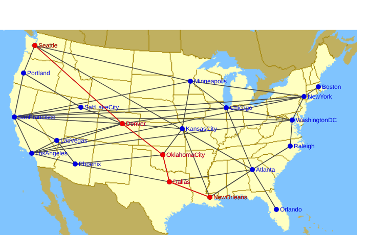
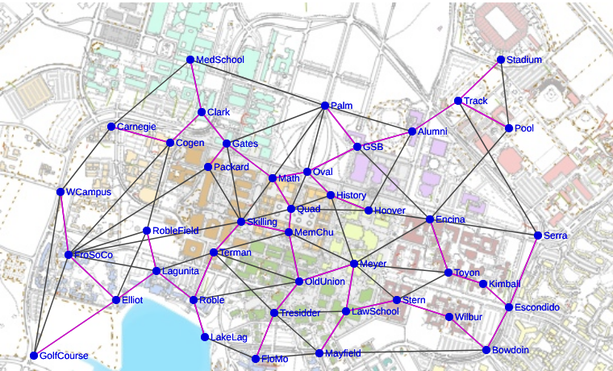

# CS106B Assignment 7 — Pathfinder

Reads a map graph from a data file, draws it over a background picture, and offers:

- **Dijkstra's algorithm**: the shortest path between two clicked locations
- **Kruskal's algorithm**: the minimal spanning tree that connects every location

| Dijkstra: Seattle → New Orleans (1880) | Kruskal: Stanford campus MST |
|---|---|
|  |  |

## Files
| File | Purpose |
|---|---|
| `pathfinder.cpp` | Graph structs, file reading, drawing, Dijkstra, Kruskal, menu |
| `pqueue.h` / `pqueue.cpp` | Task 1: the PQueue as a class template (binary heap, comparator callback, default `OperatorCmp`) |
| `pqtest.cpp` | Stand-alone PQueue tests (not part of the Pathfinder build) |
| `Small.txt`, `USA.txt`, `Stanford.txt`, `Pictures/` | Data files and background images from the starter code |
| `linux-shim/` | Stand-in CS106 library for building and testing on Linux (see below) |
| `tests/verify.py` | Checks every node pair against a Python reference implementation |

In a CS106 Xcode project, compile **only `pathfinder.cpp`**. `pqueue.cpp` is
`#include`d by `pqueue.h` and must not be added to the compiled sources.

## Design
Each line in the ARCS section becomes **one** `arcT`, stored in both
endpoints' arc lists; `OtherEnd(arc, node)` gives where it leads. The graph owns
its nodes (`Map<nodeT*>` by name) and arcs (`Vector<arcT*>`), and `FreeGraph`
deletes them.

Dijkstra keeps a `PQueue<pathT>` ordered shortest-first, a `Set` of finished
nodes, and a `Map` of the best distance known so far, so it can drop longer
paths early.

Kruskal maps each node to a *pointer* to its connected `Set`. Nodes in the same
group share one set, so "same group?" is a pointer comparison, and merging
folds the smaller set into the larger with `unionWith`.

## Building and testing on Linux
`linux-shim/` imitates the 2007 CS106 library with the same class and function
names. Graphics are saved as SVG files (set `SHIM_SVG_DIR`) and mouse clicks
are read from stdin as `x y` coordinates. It is for testing only.

```bash
cd linux-shim && make && ./pqtest
```

```bash
cd .. && linux-shim/pathfinder
```

```bash
python3 tests/verify.py USA.txt
```

Built as C++98 with AddressSanitizer and LeakSanitizer: no warnings, no leaks.
Verified 12/12 (Small), 380/380 (USA) and 1722/1722 (Stanford) shortest paths;
MST totals 3794, 5820 and 2.112 match the reference.
